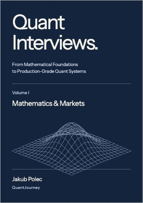
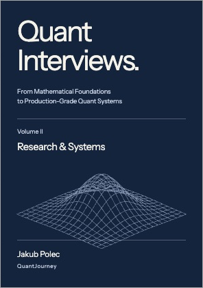
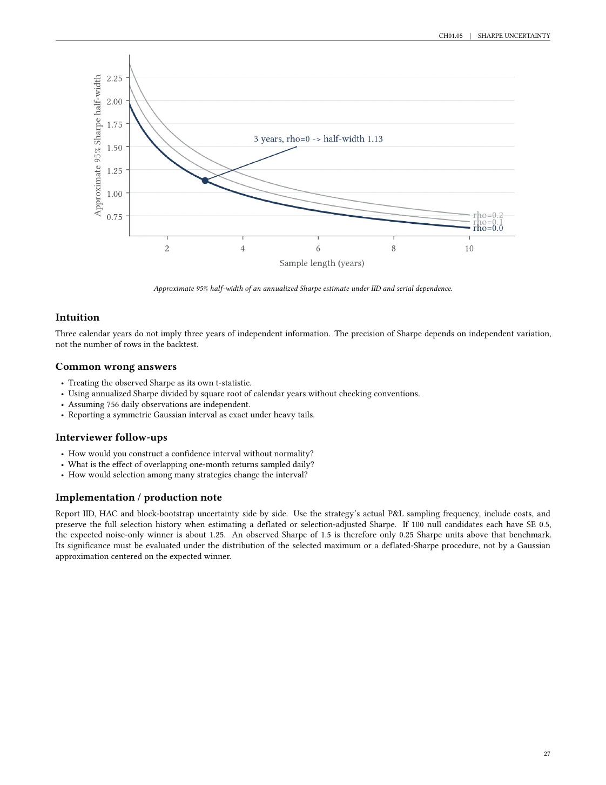
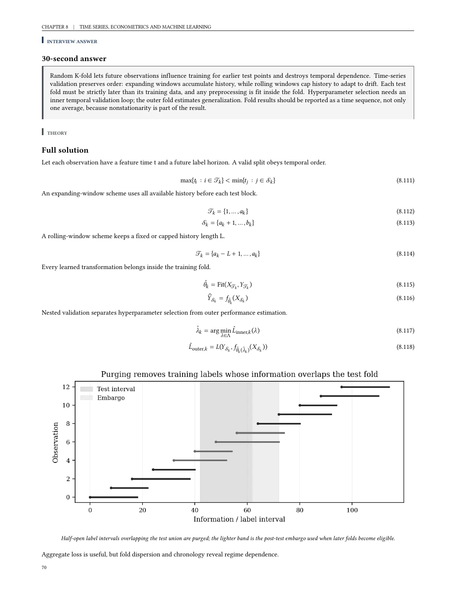
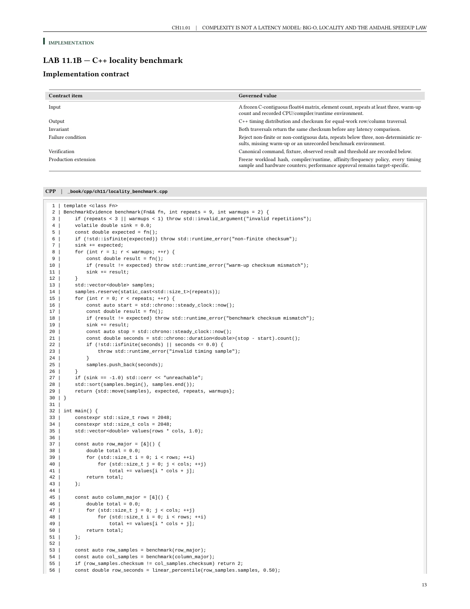
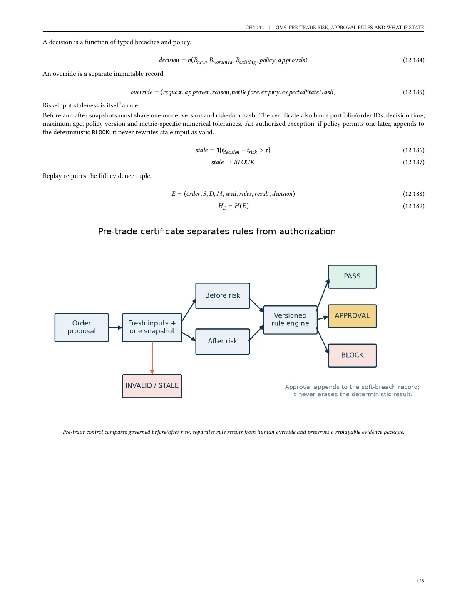

<div align="center">

# Quant Interviews

**From Mathematical Foundations to Production-Grade Quant Systems**

By **Jakub Polec** · QuantJourney

**Two volumes · Fourteen chapters · Python, C++20 and SQL**

[**Get the free PDFs**](https://quant-interviews.quantjourney.cloud/#downloads) · [**Explore the questions**](https://quant-interviews.quantjourney.cloud/#contents) · [**Printed two-volume set**](https://quant-interviews.quantjourney.cloud/#print-edition)

</div>

<table>
<tr>
<td align="center" width="50%">
<a href="https://quant-interviews.quantjourney.cloud/#contents"></a>
<br><strong>Volume I · Mathematics &amp; Markets</strong>
<br>Chapters 01–07
<br><br>Probability, optimization, stochastic calculus,<br>derivatives, volatility, rates and credit.
</td>
<td align="center" width="50%">
<a href="https://quant-interviews.quantjourney.cloud/#contents"></a>
<br><strong>Volume II · Research &amp; Systems</strong>
<br>Chapters 08–14
<br><br>Time series, portfolios, execution, programming,<br>backtesting, production systems and mock interviews.
</td>
</tr>
</table>

How much evidence does a Sharpe ratio contain? When does a pricing method fail? Can a backtest reconstruct what was actually known at the time?

*Quant Interviews* connects these questions to the mathematics, implementation and checks needed to defend an answer. The book is written for quant researchers, traders, developers, desk quants, portfolio managers and risk practitioners. This repository is its executable code companion.

The **complete digital edition is free**. [Request the download link](https://quant-interviews.quantjourney.cloud/#downloads) by email to receive both volumes and the fourteen individual chapter PDFs. The [printed set](https://quant-interviews.quantjourney.cloud/#print-edition) is available from the author.

## Inside an answer

Start with the **30-second interview answer**, then work through the derivation and its assumptions. Follow the intuition, common mistakes and interviewer follow-ups. Finally, inspect the implementation contract, reference code and tests.

The connection between reasoning and implementation runs through both volumes:

| Question to investigate | Open the implementation |
| --- | --- |
| **CH01 · How uncertain is a Sharpe ratio?** Examine sampling error and dependent returns. | [Sampling and bootstrap methods](_book/python/quant_interviews/ch01/sampling.py) |
| **CH08 · Does your validation leak information?** Inspect how overlapping labels affect train/test separation. | [Temporal validation](_book/python/quant_interviews/ch08/validation.py) |
| **CH10 · How should execution balance cost and risk?** Work through an optimal execution schedule. | [Almgren–Chriss implementation](_book/python/quant_interviews/ch10/almgren_chriss.py) |
| **CH11 · Why can the same algorithm have different latency?** Investigate memory access and locality. | [C++ locality benchmark](_book/cpp/ch11/locality_benchmark.cpp) |
| **CH12 · What did the system know at decision time?** Separate valid time from knowledge time. | [Bitemporal SQL join](_book/sql/ch12/bitemporal_feature_join.sql) |
| **CH14 · How do you evaluate an interview answer?** Inspect scoring and interviewer calibration. | [Calibration implementation](_book/python/quant_interviews/ch14/calibration.py) |

## Read the actual pages

Examples from the [book website](https://quant-interviews.quantjourney.cloud/#sample-pages). Click a page to open the full-size image.

<table>
<tr>
<td align="center" width="50%">
<strong>CH01 · Sharpe ratio uncertainty</strong><br>
<a href="https://quant-interviews.quantjourney.cloud/assets/sample-sharpe-uncertainty.webp"></a>
<br>From an estimate to the uncertainty around it.
</td>
<td align="center" width="50%">
<strong>CH08 · Purged validation</strong><br>
<a href="https://quant-interviews.quantjourney.cloud/assets/sample-purged-validation.webp"></a>
<br>Temporal splits that account for overlapping labels.
</td>
</tr>
<tr>
<td align="center" width="50%">
<strong>CH11 · C++ memory locality</strong><br>
<a href="https://quant-interviews.quantjourney.cloud/assets/sample-cpp-locality.webp"></a>
<br>Performance beyond the Big-O label.
</td>
<td align="center" width="50%">
<strong>CH12 · Orders and pre-trade controls</strong><br>
<a href="https://quant-interviews.quantjourney.cloud/assets/sample-oms-controls.webp"></a>
<br>From a proposed trade to an auditable decision.
</td>
</tr>
</table>

## Explore all fourteen chapters

Chapter links below open the corresponding Python implementation directory. Browse the [complete question list](https://quant-interviews.quantjourney.cloud/#contents) on the website.

### Volume I — Mathematics & Markets

Build the mathematical foundations, then apply them to pricing, hedging and market risk.

| Chapter | Selected topics |
| --- | --- |
| [**01 · Probability and Statistical Inference**](_book/python/quant_interviews/ch01/) | Base rates, Sharpe uncertainty, bootstrap methods, false discoveries and Bayesian updates. |
| [**02 · Linear Algebra and Optimization**](_book/python/quant_interviews/ch02/) | Covariance conditioning, PCA, Cholesky, constrained portfolios and risk parity. |
| [**03 · Calculus, PDEs and Numerical Methods**](_book/python/quant_interviews/ch03/) | Root finding, Monte Carlo, finite differences, automatic differentiation and calibration. |
| [**04 · Stochastic Processes and Stochastic Calculus**](_book/python/quant_interviews/ch04/) | Brownian motion, Itô calculus, martingales, change of measure and SDE simulation. |
| [**05 · No-Arbitrage and Derivatives**](_book/python/quant_interviews/ch05/) | State prices, put-call parity, option bounds, American exercise and local volatility. |
| [**06 · Volatility, Greeks and Options Trading**](_book/python/quant_interviews/ch06/) | Hedged P&L, smile dynamics, variance swaps, Heston, SABR and discrete hedging. |
| [**07 · Fixed Income, Rates and Credit**](_book/python/quant_interviews/ch07/) | Curve bootstrapping, key-rate risk, swaps, short-rate models and credit hazards. |

### Volume II — Research & Systems

Follow a research idea through validation, portfolio decisions, execution and the systems that support it.

| Chapter | Selected topics |
| --- | --- |
| [**08 · Time Series, Econometrics and Machine Learning**](_book/python/quant_interviews/ch08/) | Stationarity, cointegration, state-space models, temporal validation and model drift. |
| [**09 · Portfolio Construction, Risk and Performance**](_book/python/quant_interviews/ch09/) | Robust allocation, factor neutrality, tail risk, turnover, attribution and capacity. |
| [**10 · Market Microstructure and Execution**](_book/python/quant_interviews/ch10/) | Order books, queue position, price impact, optimal execution and market making. |
| [**11 · Programming, Data Structures, Python, C++ and SQL**](_book/python/quant_interviews/ch11/) | Streaming algorithms, concurrency, memory locality, numerical stability and temporal SQL. |
| [**12 · Data, Backtesting and Production System Design**](_book/python/quant_interviews/ch12/) | Point-in-time data, event-driven backtests, accounting, deterministic replay and order controls. |
| [**13 · Brainteasers, Estimation and Game Theory**](_book/python/quant_interviews/ch13/) | Fermi estimates, fair bits, optimal stopping, auctions, gambler’s ruin and invariants. |
| [**14 · Mock Interviews and Role Tracks**](_book/python/quant_interviews/ch14/) | Research, trading, pricing, developer, PM, risk and ML interviews; take-home cases and scoring. |

## Choose a starting point

These are suggested routes through the chapters; use the mock interviews in Chapter 14 to identify gaps.

| Your focus | Suggested route |
| --- | --- |
| **Quant research / ML** | 01 → 02 → 08 → 09 → 12 → 14 |
| **Pricing / desk quant** | 03 → 04 → 05 → 06 → 07 → 14 |
| **Trading / portfolio management** | 01 → 06 → 09 → 10 → 14 |
| **Quant development / platforms** | 11 → 12 → 10 → 14, with 01–04 for mathematical foundations |

## Work with the code

The repository contains implementations, tests and validators. Get the full PDFs from the book website; manuscript sources and book-production files are not included here.

| Directory | What you will find |
| --- | --- |
| [`_book/python/quant_interviews/`](_book/python/quant_interviews/) | Chapter modules for numerical methods, models, research and systems. |
| [`_book/cpp/`](_book/cpp/) | C++20 implementations, data structures and performance examples. |
| [`_book/sql/`](_book/sql/) | SQLite examples for temporal data, reconciliation and audit queries. |
| [`_project/tests/`](_project/tests/) | Python tests and C++/SQL validators organized by chapter. |

### Start with one chapter

Install [uv](https://docs.astral.sh/uv/). Use **Python 3.13**: Chapter 11 uses `math.fma`, which is unavailable in Python 3.12.

```bash
git clone https://github.com/jpolec/quant-interviews.git
cd quant-interviews
uv sync --project _project/python --python 3.13 --extra test --locked

# Run the Chapter 1 Python tests referenced by the book.
uv run --project _project/python --extra test \
  pytest _project/tests/python/ch01/test_ch01.py -q
```

Read the [Chapter 1 implementation](_book/python/quant_interviews/ch01/) beside its [tests](_project/tests/python/ch01/test_ch01.py), then use the same chapter numbering to navigate the rest of the repository.

### Run the language suites

The C++ validators require a C++20 compiler. From the repository root:

```bash
make test-python
make test-cpp
make test-sql

# Run all three targets.
make test
```

Four provenance-integration cases are skipped in this public repository because they depend on unpublished book-production assets. These skips concern publication provenance; the public repository includes the numerical and systems tests.

## Corrections and licensing

Found an error or an unclear assumption? [Open an issue](https://github.com/jpolec/quant-interviews/issues) with the chapter, question or file, and a reproducible example where possible.

- **Source code, tests and tooling:** [MIT License](LICENSE.md).
- **Book text, page previews and cover artwork:** separate from the software license. See the [book website](https://quant-interviews.quantjourney.cloud/) and [licensing boundary](LICENSING.md). The book is published under [CC BY-NC-ND 4.0](https://creativecommons.org/licenses/by-nc-nd/4.0/).
- **QuantJourney names and brand assets:** not licensed under MIT.

The examples are educational and provided without warranty. Validate assumptions and results independently before production or investment use.

---

**Read the book. Inspect the implementation. Test the assumptions.**

[Free digital edition](https://quant-interviews.quantjourney.cloud/#downloads) · [All interview questions](https://quant-interviews.quantjourney.cloud/#contents) · [Printed two-volume set](https://quant-interviews.quantjourney.cloud/#print-edition)
