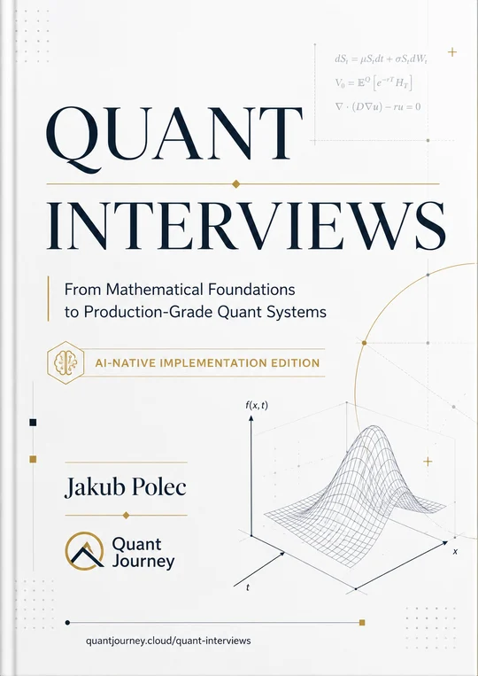

# Quant Interviews — code companion

The public implementation repository for
[Quant Interviews](https://quant-interviews.quantjourney.cloud): executable
examples in Python, C++20 and SQL, organized by the book's fourteen chapters.

This repository intentionally contains code and code tests only. It does not
contain the manuscript source, book-production files or rendered PDF editions.
The complete book and individual chapter PDFs are available free from the book website.

## Get the book

<a href="https://quant-interviews.quantjourney.cloud/">
  
</a>

**Two volumes, one complete book by Jakub Polec.**

| Volume | Chapters | Topics |
| --- | --- | --- |
| **I — Mathematics & Markets** | CH01–CH07 | Probability, statistics, linear algebra, numerical methods, stochastic processes, derivatives, volatility, rates and credit. |
| **II — Research & Systems** | CH08–CH14 | Time series, machine learning, portfolio construction, execution, programming, production systems and interview practice. |

- **[Get both volumes — free PDF](https://quant-interviews.quantjourney.cloud/#downloads)**. The website sends the download link by email. It includes both volumes and the fourteen individual chapter PDFs.
- **[Browse all fourteen chapters](https://quant-interviews.quantjourney.cloud/#contents)** and their interview questions.
- **[Get the printed two-volume set](https://quant-interviews.quantjourney.cloud/#print-edition)**.

This repository supplies the Python, C++20 and SQL implementations that accompany the book.

## Contents

| Path | Contents |
| --- | --- |
| `_book/python/` | 210 Python files · 48,408 lines |
| `_book/cpp/` | 44 C++20 files · 4,334 lines |
| `_book/sql/` | 53 SQLite files · 5,717 lines |
| `_project/tests/` | 68 public, code-only test and validator files |

The paths mirror the canonical implementation tree used to produce the code
listings in the book.

## Run the tests

Install [uv](https://docs.astral.sh/uv/) and a C++20 compiler, then run:

```bash
uv sync --project _project/python --extra test --locked
make test
```

You can run the language suites separately with `make test-python`,
`make test-cpp` or `make test-sql`.

The CH01 Python tests shown in the book are in
`_project/tests/python/ch01/test_ch01.py`. They use the public implementation
modules and synthetic fixtures; no manuscript or private assets are required.
Run just these tests with:

```bash
uv run --project _project/python --extra test pytest _project/tests/python/ch01/test_ch01.py -q
```

Four provenance-integration cases are skipped in this code-only repository
because they bind hashes to book-production assets that are intentionally not
published here. The underlying numerical and systems implementations remain
covered by the public suites.

## License and scope

The code in this repository is released under the [MIT License](LICENSE.md).
See [LICENSING.md](LICENSING.md) for the explicit boundary between the code,
the book/PDF content and QuantJourney brand assets.
It is educational material and is provided without warranty. Examples,
datasets, backtests and model outputs are illustrative; validate them
independently before any production or investment use.

Issues and corrections are welcome through
[GitHub Issues](https://github.com/jpolec/quant-interviews/issues).
